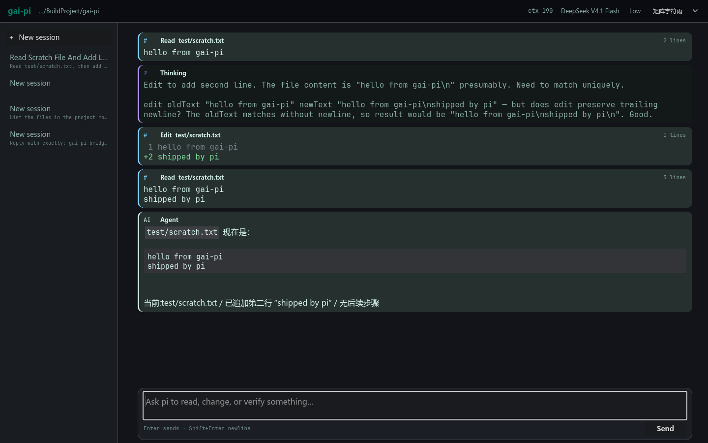

# gai-pi

**pi 的桌面端。** 外壳是一个 Godot 4.6 场景（沿用 [gai](https://github.com/godot-fun/gai) 的视觉语言：
GPU 绘制的界面、shader 动效、随工具调用起伏的 60 个场景），大脑是官方 `pi --mode rpc` 子进程。

```
工具栏   gai-pi · 工作目录 ······ ctx 3.2k · 模型 · thinking · 视觉场景
┌──────────────┬─────────────────────────────────────────────────────┐
│ ＋ 新会话     │  > 你: 把这个模块的轮询改成事件驱动                    │
│              │  # Edit  src/poller.ts            -18 +42           │
│ 会话列表      │    [内联 diff，逐行着色]                              │
│ (来自 pi)     │  AI Agent: 改完了，测试通过……                          │
│              │─────────────────────────────────────────────────────│
│              │  [ 输入框                              ] 发送 / 停止  │
└──────────────┴─────────────────────────────────────────────────────┘
```



## 为什么这么做

- **pi 负责大脑**：循环、工具、会话、压缩、模型、skills、扩展，全在 pi 里，
  桌面端不重复实现，也不和它抢真相。
- **gai 负责身体**：60 个 `VisualEffect` 场景原样复用（MIT）。gai 的事件总线本来就和 pi 的
  会话事件同形，所以效果文件零改动。
- **进程边界**：`pi --mode rpc` 是官方给自定义 UI 的通道，JSONL 进出。模型崩了不带崩窗口。

## 环境要求

- Windows 10/11（Linux/macOS 的启动脚本也已写好，未实测）
- **Node.js 20+**
- **pi 已安装**：`npm i -g @earendil-works/pi-coding-agent`，并已配置好 provider（`pi` 能直接跑）
- 仓库内自带 Godot：`.dependency/godot/Godot_v4.6.3-stable_win64_console.exe`

gai-pi 不安装、不修改 pi。它读 `PI_CODING_AGENT_DIR`（默认 `~/.pi/agent`）里的配置和会话，
用的是你现有的模型和凭据。

## 运行

```bash
# 双击 gai-pi.cmd，或：
.dependency/godot/Godot_v4.6.3-stable_win64_console.exe --path .

# 无窗口自检：启动 pi → 握手 → 发一句话 → 等结算
.dependency/godot/Godot_v4.6.3-stable_win64_console.exe --headless --path . --script test/bridge_smoke.gd

# 截图自检
GAI_PI_VISUAL=4 GAI_PI_SCREENSHOT=.verify/run.png GAI_PI_SCREENSHOT_DELAY=45000 \
  .dependency/godot/Godot_v4.6.3-stable_win64_console.exe --path .
```

首次打开会在右上角显示当前模型；点工作目录切换项目。工作目录会记住（`user://gai-pi.cfg`）。

## 操作

| 操作 | 键/入口 |
| --- | --- |
| 发送 | `Enter` |
| 换行 | `Shift+Enter` |
| 运行中插话 | 直接发送：默认 `steer`（本回合工具跑完后插入），可在设置里改成 `followUp` |
| 停止 | 输入框右侧「停止」 |
| 切换/新建会话 | 左侧栏 |
| 选模型 / thinking | 右上角 |
| 换视觉场景 | 右上角下拉（60 个） |
| 展开长输出 / diff | 点气泡头部 |

## 自检钩子（环境变量）

| 变量 | 作用 |
| --- | --- |
| `GAI_PI_VISUAL` | 启动时强制视觉场景序号 |
| `GAI_PI_AUTOPROMPT` | 启动后自动发送这句话（录制/验收用） |
| `GAI_PI_SCREENSHOT` / `GAI_PI_SCREENSHOT_DELAY` | 到点截图并退出 |
| `GAI_PI_SMOKE_PROMPT=0` | 只验证启动，不调用模型 |
| `GAI_PI_NODE` / `GAI_PI_CLI` | 覆盖 node / pi bundle 路径 |
| `GAI_PI_SESSION` | 启动后打开指定会话（uuid 或 jsonl 路径） |

## 现在能做什么，不能做什么

已完成：启动握手、流式文本与思考、工具气泡（含 `edit` 内联 diff）、运行/停止、
steer 队列、会话列表与切换、模型与 thinking 切换、上下文压缩事件、60 个视觉场景、多工作目录。

未完成（详见 [ARCHITECTURE.md](ARCHITECTURE.md#八边界与已知不足)）：扩展弹窗交互、
Git 检查点回滚、图片粘贴、编辑器面板、并发多会话、打包分发。

## 文档

- [ARCHITECTURE.md](ARCHITECTURE.md)：gai 的拆解、pi 的能力边界、协议映射表、踩过的坑
- [CREDITS.md](CREDITS.md)：gai / zfoo 的 MIT 授权与复制清单

## 授权

MIT。界面资产来自 gai（`Copyright (c) 2026 godot-fun`，MIT），见 CREDITS。
