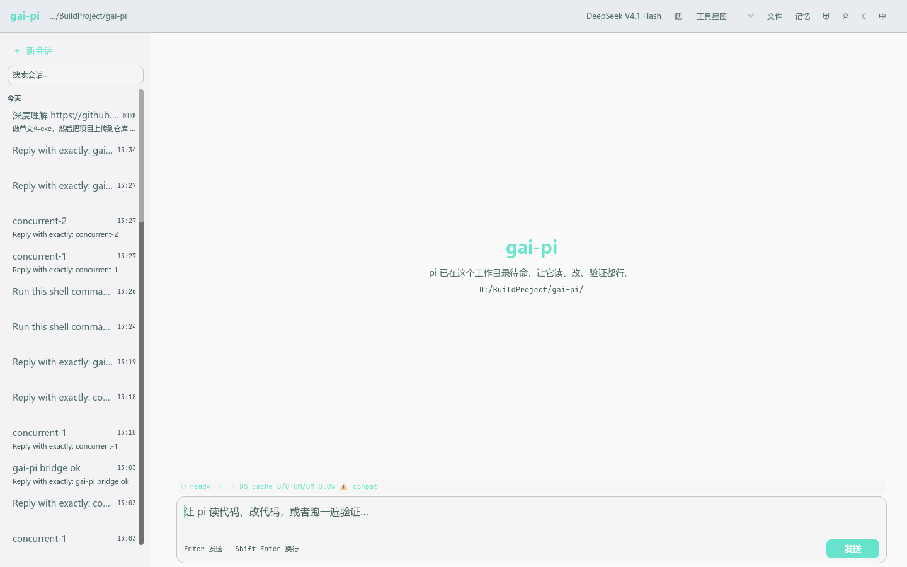
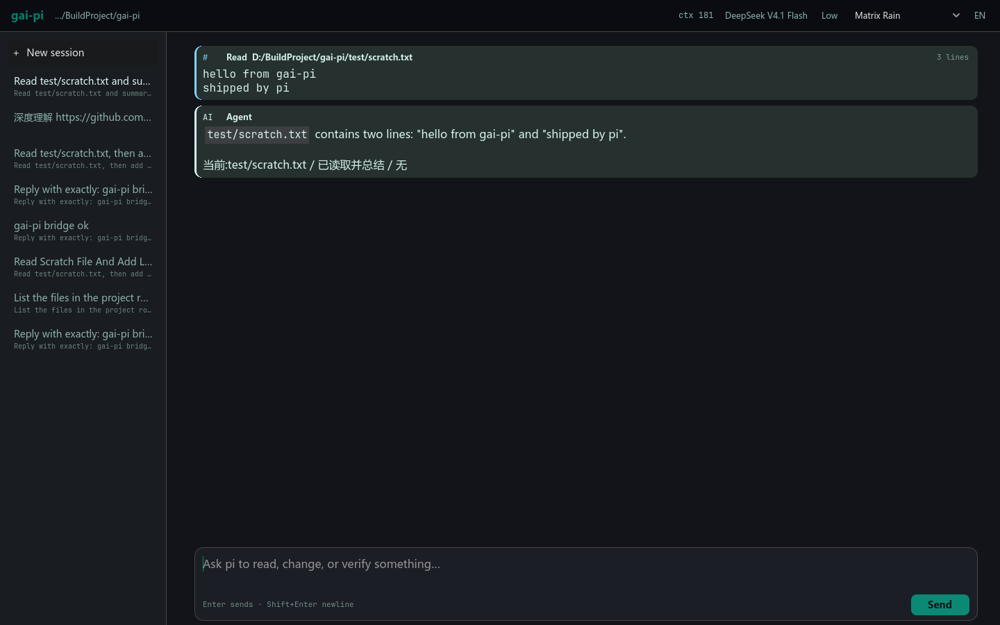

<p align="center">
  
</p>

<h1 align="center">gai-pi</h1>

<p align="center"><b>pi 的桌面端：Godot 4.6 外壳 + 官方 RPC。</b></p>

<p align="center">
  
  
  
  
</p>

<p align="center"><i>大脑是 pi，身体是 gai。整个界面是一个 Godot 场景，会话、工具、检查点都是真的。</i></p>



> **基于 [godot-fun/gai](https://github.com/godot-fun/gai)（MIT）。** 界面资产、60 个动效场景、
> 主题与编辑器思路 fork 自原项目；agent 大脑换成 [pi](https://github.com/earendil-works/pi)，
> 通过官方 `--mode rpc` 接入。这不是换皮：循环、工具、会话、压缩、模型全部由 pi 提供，
> 外壳只负责把它画出来、把操作送回去。详见 [与原版的关系](#与原版-gai-的关系)。

---

## 为什么是“外壳 + 大脑”

pi 已经是一个完整的编码 agent：循环、工具、会话树、压缩、模型、skills、MCP、扩展。
它缺的是一张能长时间盯着看的脸。gai 证明了这类界面可以是 GPU 绘制的、有呼吸感的，
而不是又一个 DOM 聊天框。

gai-pi 把两边接起来：

```text
┌──────────────────────── Godot 4.6 进程 ────────────────────────┐
│  工具栏 / 会话侧栏 / 转录 / 输入框 / 文件浏览器 / 60 个动效       │
│  app/bridge：pi 的 RPC 客户端、事件→气泡映射、检查点、安全模式    │
└───────────────────────────────┬────────────────────────────────┘
                                │ cmd.exe /c launcher → node cli.js --mode rpc
                                │ JSONL（命令、响应、会话事件、扩展 UI）
┌───────────────────────────────▼────────────────────────────────┐
│  pi 进程：loop / tools / sessions / compaction / models / skills │
└─────────────────────────────────────────────────────────────────┘
```

一个会话一个 pi 进程，所以多个会话可以同时跑；已打开的会话切回来不起进程，只重放窗口。

---

## 亮点

- **真的在干活**：流式思考与正文、工具气泡、`edit` 内联 diff、停止/插话、排队消息。
- **每轮都是检查点**：影子 Git 仓库给每个回合打两枚提交，可整轮回滚，也可只撤销某一次
  `edit`/`write`。用户的 `.git` 不会被写。
- **编辑器在窗口里**：文件树、多标签、语法高亮（GDScript/JSON/Markdown…）、Markdown 预览、
  图片、当前文件 vs 上个检查点的 diff。
- **会话像会话**：搜索、置顶、重命名、删除、按天分组、相对时间、运行中标记。
- **60 个动效场景**：矩阵雨、推理树、记忆河流、天体……选中即预览，运行中跟着工具调用走。
- **图片进对话**：`Ctrl+V` 或拖拽，自动缩放后作为 pi 的 `ImageContent` 发出去。
- **扩展不是黑盒**：`setStatus`/`setWidget` 进输入框上方的状态条，`confirm/select/input/editor`
  渲染成弹窗并回写，`notify` 进顶栏。
- **安全模式**：文件工具越出工作目录、或命令命中高危词表时中止本轮（事后拦截，见文档）。
- **记忆面板**：直接编辑 `AGENTS.md` / `MEMORY.md` / `SYSTEM.md` / `SKILLS.md` / `.memory/*.md`。
- **双语与主题**：中/英实时切换、深/浅主题，都记住；`⌕` 或 `Ctrl+F` 搜聊天记录。

| 中文 | English |
| --- | --- |
|  |  |

---

## 快速开始

**需要**：Windows 10/11、Node.js 20+、已经装好并配置好 provider 的 pi
（`npm i -g @earendil-works/pi-coding-agent`，确保 `pi` 能直接跑）。仓库自带 Godot 4.6.3 于
`.dependency/godot/`。

```bash
git clone https://github.com/z416946520/gai-pi.git
cd gai-pi

# 双击 gai-pi.cmd，或者：
.dependency/godot/Godot_v4.6.3-stable_win64_console.exe --path .

# 无窗口自检（启动 → 握手 → 发一句话 → 等结算）
.dependency/godot/Godot_v4.6.3-stable_win64_console.exe --headless --path . --script test/bridge_smoke.gd
```

首次打开会新建一个会话；点左上角工作目录切换项目。gai-pi 不安装、不修改 pi，用的是你现有的
配置、凭据和会话（`PI_CODING_AGENT_DIR`，默认 `~/.pi/agent`）。

---

## 操作

| 操作 | 方式 |
| --- | --- |
| 发送 / 换行 | `Enter` / `Shift+Enter` |
| 运行中插话 | 直接发送（默认 steer，可改 followUp） |
| 停止 | 输入框右侧「停止」 |
| 切换/新建会话 | 左侧栏；搜索框过滤，右键置顶/重命名/删除 |
| 选模型 / thinking | 右上角 |
| 换视觉场景 | 右上角下拉（60 个） |
| 复制 / 放回输入框 | 悬停气泡，右上角 `⧉` 与 `↩` |
| 撤销文件修改 / 回滚整轮 | 气泡下方「撤销这次文件修改」 / 检查点气泡「撤销本轮」 |
| 浏览文件 / diff | 右上角「文件」，`Δ` 对比上个检查点 |
| 搜聊天记录 | `Ctrl+F` 或 `⌕` |
| 安全模式 | 右上角盾牌 |
| 改记忆文件 | 右上角「记忆」 |
| 切语言 / 主题 | 右上角 `中` / `EN`、`☀` / `☾` |

---

## 自检钩子

用于截图与验收的环境变量：`GAI_PI_SCREENSHOT` / `GAI_PI_SCREENSHOT_DELAY`、`GAI_PI_AUTOPROMPT`、
`GAI_PI_SESSION`、`GAI_PI_VISUAL`、`GAI_PI_PREVIEW_VISUAL`、`GAI_PI_THEME`、`GAI_PI_SWITCH_THEME`、
`GAI_PI_SWITCH_LOCALE`、`GAI_PI_LOCALE`、`GAI_PI_SEARCH`、`GAI_PI_SEARCH_JUMP`、`GAI_PI_EDITOR`、
`GAI_PI_EDITOR_FILE`、`GAI_PI_EDITOR_DIFF`、`GAI_PI_MEMORY`、`GAI_PI_SAFETY`、`GAI_PI_ATTACH_IMAGE`、
`GAI_PI_FAKE_DIALOG`、`GAI_PI_NODE` / `GAI_PI_CLI`。

## 测试

```bash
godot --headless --path . --script test/bridge_smoke.gd      # 启动/流式/结算/会话切换
godot --headless --path . --script test/concurrency_test.gd   # 两个 pi 进程同时跑
godot --headless --path . --script test/checkpoint_test.gd    # 快照/文件列表/diff/回滚
godot --headless --path . --script test/snapshot_test.gd      # edit/write 单文件撤销
godot --headless --path . --script test/search_test.gd        # 转录匹配
godot --headless --path . --script test/safety_test.gd        # 安全模式规则
```

---

## 与原版 gai 的关系

| | gai | gai-pi |
| --- | --- | --- |
| agent 大脑 | GDScript 自研循环 + 18 个工具 | **pi**（RPC 子进程）：循环、工具、会话、压缩、模型 |
| 界面 | Godot 场景 | 复用同一套设计语言 + 60 个动效场景（MIT） |
| 检查点 | 用户仓库的 Git | **影子 Git**，不碰用户 `.git`，另加单文件撤销 |
| 会话 | 自有 JSON 存储 | pi 的 JSONL 会话树，一个会话一个进程 |
| 编辑器 | 文件树/标签/预览/Git Bash | 文件树/标签/高亮/diff/预览（无写操作、无终端） |
| 记忆 | `.memory/` + 后台整理代理 | 面板读写上下文 Markdown；后台整理未移植 |
| 语音 / 资产技能 / 本地 VLM | 有 | 未移植（走 pi 的 provider 与扩展） |

gai 的 MIT 授权与复制清单在 [CREDITS.md](CREDITS.md)。复制的部分集中在 `zfoo/`、
`app/visuals/`、`app/markdown/`、`app/locale/`、`app/ui/code/` 与 `icon.svg`（像素字 AI→PI）。

## 文档

- [ARCHITECTURE.md](ARCHITECTURE.md)：协议映射、进程模型、性能取舍、踩过的坑、边界
- [CREDITS.md](CREDITS.md)：来源与授权

## 授权

MIT。界面资产来自 gai（`Copyright (c) 2026 godot-fun`，MIT），见 [CREDITS.md](CREDITS.md)。
